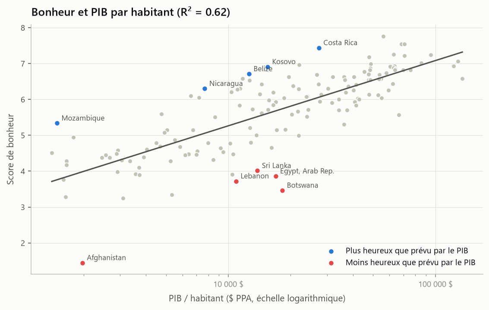
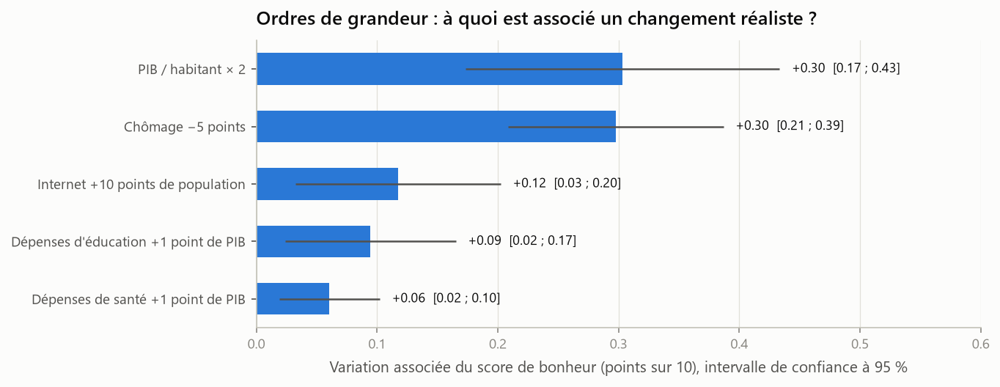

# WorldPulse — Qu'est-ce qui rend un pays heureux ?

 

> **In English.** Which factors explain how happy a country is? I combined 7 World Bank indicators with the World Happiness Report scores (146 countries, 2026 report), then selected variables with explicit statistical criteria (adjusted R², AIC/BIC, Lasso stability, nested cross-validation). A 5-variable linear regression explains **≈ 63 % of the differences on countries it has never seen**; GDP and **unemployment** are the two main factors. Governance adds nothing beyond wealth, and the Easterlin paradox does not hold over 2016–2026. All results are associations, not causal effects.

**Le problème.** Une ONG internationale veut savoir quels facteurs (richesse, santé, éducation, internet, emploi, urbanisation) expliquent le niveau de bonheur d'un pays, pour orienter ses actions.

**La méthode.** 7 indicateurs de la World Bank (API) + le score de bonheur du *World Happiness Report* (scraping Wikipedia), fusionnés par code pays ISO3, pour 146 pays. Puis analyse exploratoire, sélection de variables justifiée par des métriques, comparaison de modèles en validation croisée, clustering et deux analyses complémentaires.

📄 **[Lire le rapport complet, sans code](reports/rapport_worldpulse.html)** (à télécharger et ouvrir dans un navigateur) · 📓 **[Notebook avec le code](notebooks/rapport_worldpulse.ipynb)**



## Résultats clés

| | Résultat |
|---|---|
| 🎯 **Précision** | Le modèle retenu (régression linéaire, 5 variables) explique **≈ 63 % des écarts de bonheur sur des pays qu'il n'a jamais vus** (validation croisée imbriquée), avec une erreur moyenne de 0,5 point sur 10. Sur l'échantillon d'apprentissage, il atteint 76 % : c'est l'écart normal entre un score optimiste et un score honnête. |
| 💰 **Richesse** | Un **PIB par habitant doublé** va de pair avec **+0,30 point** de bonheur [0,17 ; 0,43], à autres variables égales. |
| 🏭 **Emploi** | **5 points de chômage en moins** vont de pair avec **+0,30 point** [0,21 ; 0,39], autant qu'un PIB doublé. Le groupe de pays « Chômage élevé » (15 pays, chômage à 20 %) est 50 % plus riche que le groupe « En développement », mais **pas plus heureux** (médiane 4,5 dans les deux cas). |
| 📈 **Easterlin** | Le paradoxe d'Easterlin **ne se vérifie pas** sur 2016–2026 : quand un pays s'enrichit, son bonheur augmente (pente de 3,5 à 3,8 points pour un PIB × 10, contre 1,8 entre pays). |

**Pourquoi l'effet du PIB est-il plus faible dans le modèle (≈ +1,0 point par PIB × 10) que dans la comparaison simple entre pays (1,8) ?** Parce que le modèle contrôle les autres variables, surtout internet, corrélé à 0,89 au PIB : en ajoutant internet seul, l'effet du PIB passe de 1,8 à 1,3, puis à 1,0 avec le chômage et les dépenses publiques. Le modèle isole ce qui revient au PIB seul.



## Une démarche rigoureuse

- **Pas de fuite de données** : les colonnes « facteurs » des tableaux du World Happiness Report (*GDP per capita*, *Social support*…) sont des morceaux du score lui-même ; elles sont exclues. Les valeurs manquantes sont imputées **à l'intérieur** de la validation croisée.
- **Choix des variables justifié par des chiffres** : R² ajusté, AIC, BIC et Cp de Mallows sur les 127 combinaisons possibles, VIF, stabilité du Lasso sur 500 échantillons, régression sur composantes principales. Règles de décision fixées **avant** de voir les résultats.
- **Score honnête** : la sélection de variables est refaite dans chaque pli d'une **validation croisée imbriquée**, pour ne pas surestimer la précision (0,65 si l'on choisit et évalue sur les mêmes données, 0,63 en version honnête).
- **Hypothèses vérifiées** : normalité des résidus (Shapiro-Wilk p = 0,94), variance constante (Breusch-Pagan p = 0,12), aucun pays dominant (distance de Cook < 1).
- **Modèles plus complexes testés** : Random Forest (0,63) et XGBoost (0,60) ne font pas mieux et surapprennent (R² d'entraînement de 0,88 et 0,99).
- **Associations, pas causes** : les explications venues de l'extérieur sont présentées comme des hypothèses, avec leur source.

## Recommandations pour l'ONG

Le détail, avec les chiffres et les limites de chaque recommandation, est dans la section 11 du rapport.

1. **Faire de l'emploi une priorité**, en particulier dans les pays à chômage élevé (Afrique australe, Maghreb, Moyen-Orient). *Limite* : le lien peut aller dans les deux sens, et l'emploi informel n'est pas mesuré.
2. **Soutenir le développement économique, mais suivre le bonheur lui-même dans le temps.** Le PIB seul n'est pas une alarme fiable : le Congo a perdu 31 % de PIB sans perdre de bonheur, alors que la Sierra Leone en a perdu malgré la croissance. *Limite* : 10 ans de recul seulement.
3. **Considérer internet et les dépenses de santé et d'éducation comme des leviers complémentaires** : leurs effets sont réels, mais 3 à 5 fois plus petits. *Limite* : internet est aussi un marqueur du développement, et les données d'éducation sont fragiles.
4. **Adapter les actions au profil du pays** (3 profils issus du clustering) et compléter par des données de terrain : environ un tiers des écarts restent inexpliqués, et la gouvernance n'apporte rien de plus que la richesse. *Limite* : les frontières entre profils sont floues.

## Limites

- **Associations, pas causes** : le modèle ne dit pas ce qui se passerait si l'on changeait une variable dans un pays donné.
- **Peu de données** : 146 pays, donc des intervalles de confiance larges.
- **Moyennes nationales** : rien sur les inégalités de bonheur à l'intérieur d'un pays.
- **Données récentes incomplètes** : la World Bank publie avec 1 à 3 ans de retard (dépenses d'éducation surtout : valeur ancienne pour 54 pays, absente pour 11), et les indicateurs de gouvernance archivés s'arrêtent en 2023.
- **Comparabilité** : les dépenses d'éducation du Nigeria, par exemple, ne couvrent que le budget fédéral (≈ 0,3 % du PIB). Taiwan est exclu, faute de données World Bank.
- **Facteurs absents** : liens sociaux, sécurité, inégalités de revenus, santé mentale.

## Relancer le projet

Windows / PowerShell, Python 3.12 :

```powershell
py -3.12 -m venv .venv
.\.venv\Scripts\Activate.ps1
pip install -r requirements.txt

# Tout relancer : scripts src/01 à src/08 dans l'ordre (~15 min, téléchargements compris)
python run_all.py
# ou repartir des données déjà présentes dans data/raw/
# (l'étape 07 retélécharge tout de même les indicateurs de gouvernance)
python run_all.py --depuis 03

# Rapport : exécuter le notebook, puis exporter la version sans code
jupyter nbconvert --to notebook --execute --inplace notebooks/rapport_worldpulse.ipynb
jupyter nbconvert --to html --no-input --output-dir reports --output rapport_worldpulse notebooks/rapport_worldpulse.ipynb
```

Les données téléchargées en novembre 2026 sont versionnées dans `data/` : deux sources ont changé pendant le projet (API World Bank en erreur 502, indicateurs de gouvernance archivés), et cet instantané garantit que les résultats restent reproductibles. La base SQLite `db/worldpulse.db` n'est pas versionnée ; elle est recréée par l'étape 04.

## Structure du projet

```
├── run_all.py                    # relance les étapes 01 à 08
├── src/
│   ├── 01_extraction_api.py      # API World Bank : pays + 7 indicateurs (ZIP/CSV)
│   ├── 02_scraping_wikipedia.py  # tableaux du World Happiness Report
│   ├── 03_nettoyage_fusion.py    # codes ISO3, agrégation, fusion
│   ├── 04_base_sqlite.py         # base db/worldpulse.db + requêtes d'exemple
│   ├── 05_modelisation.py        # sélection des variables, modèles, SHAP
│   ├── 06_clustering.py          # K-Means, ACP
│   ├── 07_gouvernance.py         # test : indicateurs de gouvernance (WGI)
│   └── 08_easterlin.py           # test : paradoxe d'Easterlin
├── data/raw/                   # données brutes, jamais modifiées
├── data/processed/             # données nettoyées et fusionnées
├── reports/                    # résultats (CSV), figures, rapport HTML
├── notebooks/rapport_worldpulse.ipynb  # rapport complet avec le code
└── docs/dictionnaire_donnees.md         # sens de chaque colonne de chaque fichier
```

Le sens de chaque variable et de chaque fichier est décrit dans le **[dictionnaire des données](docs/dictionnaire_donnees.md)**.

## Sources et licences

| Source | Accès | Licence |
|---|---|---|
| [World Bank — World Development Indicators](https://data.worldbank.org/) : 7 indicateurs, 2013–2025 | API publique, téléchargement ZIP/CSV | [CC BY 4.0](https://creativecommons.org/licenses/by/4.0/) |
| [World Bank — Worldwide Governance Indicators](https://www.worldbank.org/en/publication/worldwide-governance-indicators) : 3 indicateurs, 2023 | téléchargement ZIP (source archivée) | [CC BY 4.0](https://creativecommons.org/licenses/by/4.0/) |
| [Wikipedia — World Happiness Report](https://en.wikipedia.org/wiki/World_Happiness_Report) : scores de bonheur par pays | scraping, une seule requête, User-Agent identifiable | [CC BY-SA 4.0](https://creativecommons.org/licenses/by-sa/4.0/) |

Les scores de bonheur proviennent à l'origine du *World Happiness Report* (Helliwell, Layard, Sachs et al.), à partir des enquêtes Gallup World Poll. Le code de ce dépôt est sous licence [MIT](LICENSE) ; les données conservent la licence de leur source.

---

## Analyse détaillée

### Choix méthodologiques

- **Modèle principal : rapport 2026**, enquêtes 2023–2025. Les indicateurs World Bank sont moyennés sur ces mêmes années.
- **Pas de colonnes « facteurs » du WHR.** Les colonnes *GDP per capita*, *Social support*… des tableaux Wikipedia sont des décompositions du score lui-même. Les utiliser pour prédire le score serait une fuite de données.
- **Indicateurs récupérés en ZIP/CSV.** En novembre 2026, l'API JSON de données renvoyait des erreurs 502. Le téléchargement groupé donne les mêmes données officielles en 7 requêtes.
- **Rapports exploitables :** 2016–2020 et 2024–2026. Sur Wikipedia, les rapports 2022–2023 n'ont pas de score, 2021 et 2014–2015 sont absents, et 2013 ne couvre que les 85 premiers pays.
- **Données brutes jamais modifiées.** Tout le nettoyage se fait à l'étape 4.
- **Pays → ISO3** avec `country_converter`. Corrections manuelles : *Northern Cyprus* et *Somaliland region* (sinon confondus avec Chypre et la Somalie), *World* et *Europe* exclus.
- **Agrégation des indicateurs.** Moyenne sur les années d'enquête du rapport ; sinon, dernière valeur des 3 années précédentes. Pour 2026, le repli concerne surtout les dépenses d'éducation (54 pays sur 146). Le détail par indicateur est dans `data/processed/qualite_indicateurs_2026.csv`.
- **Valeur aberrante.** Les dépenses d'éducation de la Somalie (≈ 0 % du PIB) sont traitées comme manquantes.
- **Valeurs manquantes conservées.** Il en reste 19, réparties sur 12 pays ; 134 pays sur 146 sont complets. Elles sont imputées à la médiane à l'étape 7, à l'intérieur de la validation croisée (médiane apprise sur les plis d'entraînement seulement), pour éviter une fuite de données.
- **pandas < 3** : `country_converter` 1.3.2 est incompatible avec pandas 3.
- **`log_pib` = log10(PIB par habitant)** remplace le PIB brut pour la modélisation : la distribution du PIB est très asymétrique (asymétrie 1,54 → −0,37 après le log), et son lien avec le bonheur est linéaire en échelle logarithmique.

### Analyse exploratoire (rapport 2026)

- Le PIB (log, r = 0,79), internet (0,76) et l'espérance de vie (0,74) sont les indicateurs les plus liés au bonheur. Le PIB explique à lui seul 62 % des écarts entre pays **sur l'échantillon** (58 % sur des pays inconnus, en validation croisée).
- Ces trois indicateurs sont très corrélés entre eux (0,84–0,89) : leur effet est à lire comme un bloc « développement ».
- Les dépenses de santé et d'éducation (% du PIB) et le chômage sont faiblement liés au bonheur.
- Plusieurs pays d'Amérique latine sont bien plus heureux que leur PIB ne le prévoit, et l'Afghanistan, le Liban, l'Égypte ou le Botswana bien moins. Les explications avancées (liens sociaux selon le WHR 2018, chapitre 6 ; inégalités ; crises) restent des hypothèses.
- Le score médian progresse de 5,31 (2016) à 5,94 (2026).

### Modélisation et sélection des variables (rapport 2026)

Démarche complète dans la section 7 du notebook. Règles de décision fixées avant de voir les résultats.

**1. Modèle complet (7 variables, 134 pays complets).** R² 0,764, R² ajusté 0,751, AIC 223,7, BIC 246,9, test F p ≈ 10⁻³⁶. L'espérance de vie (p = 0,92) et l'urbanisation (p = 0,95) ne sont pas significatives. Multicolinéarité notable mais pas critique : VIF max 7,2 (PIB), 6,1 (internet), 5,3 (espérance de vie).

**2. Hypothèses vérifiées.** Résidus normaux (Shapiro-Wilk p = 0,94 ; Jarque-Bera p = 0,98), variance constante (Breusch-Pagan p = 0,12), aucun pays dominant (distance de Cook max 0,22 < 1, Botswana).

**3. Sélection des variables.**

| Méthode | Résultat |
|---|---|
| 127 combinaisons, sur l'échantillon (R² ajusté, AIC, BIC, Cp) | les 4 critères retiennent le même modèle à 5 variables |
| 127 combinaisons, validation croisée | RMSE quasi identique de 3 à 7 variables (0,645 à 0,660, ± 0,04) |
| Lasso, 500 bootstraps | chômage 100 %, PIB 99 %, éducation 98 %, internet 98 % ; espérance de vie la moins stable (65 %) |
| ACP (1 à 7 composantes) | pas mieux que la sélection (meilleure RMSE 0,651), et coefficients illisibles |
| Validation croisée imbriquée de 5 procédures | règle de l'écart-type écartée (R² 0,57) ; RMSE min, BIC, Lasso et aucune sélection à égalité → la plus simple : **BIC** |

**Modèle retenu : PIB (log), internet, chômage, dépenses de santé, dépenses d'éducation.** Il écarte l'espérance de vie et l'urbanisation. R² ajusté 0,755 (contre 0,751), BIC 237,1 (contre 246,9).

**4. Performance hors échantillon** (5 plis × 10, mêmes plis pour tous les modèles)

| Modèle | MAE | RMSE | R² test | R² entraînement |
|---|---|---|---|---|
| Référence (moyenne) | 0,96 | 1,14 | −0,03 | 0,00 |
| Régression — PIB seul | 0,54 | 0,72 | 0,58 | 0,61 |
| Régression — 7 variables | 0,50 | 0,66 | 0,64 | 0,72 |
| **Régression — 5 variables retenues** | **0,48** | **0,65** | **0,65** | 0,71 |
| Lasso | 0,49 | 0,66 | 0,64 | 0,72 |
| Régression sur 2 composantes (ACP) | 0,51 | 0,68 | 0,62 | 0,66 |
| Random Forest | 0,50 | 0,67 | 0,63 | 0,88 |
| XGBoost | 0,54 | 0,70 | 0,60 | 0,99 |

Estimation honnête, qui inclut l'étape de sélection (validation croisée imbriquée) : **R² ≈ 0,63, RMSE ≈ 0,67**. Les modèles d'arbres surapprennent sans mieux généraliser.

**5. Effets estimés** (à autres variables égales, IC à 95 %)
- PIB × 2 → +0,30 point (coefficient +1,01 [0,58 ; 1,44] par log10) ;
- +5 points de chômage → −0,30 point ;
- +10 points d'accès à internet → +0,12 point ;
- +1 point de PIB en dépenses d'éducation → +0,09 ; en dépenses de santé → +0,06.

Environ un tiers des écarts restent inexpliqués. *Hypothèse* : conflits, liens sociaux. La gouvernance a été testée et n'explique presque rien de plus (voir plus bas).

### Clustering (K-Means, k = 3, silhouette 0,38)

Les groupes sont formés sur les 7 indicateurs standardisés, sans utiliser le score de bonheur.

| Groupe | Pays | Profil | Bonheur (médiane) |
|---|---|---|---|
| Développés et émergents | 87 | PIB ≈ 35 000 $, 89 % sur internet | 6,4 |
| En développement | 44 | PIB ≈ 4 900 $, 45 % sur internet, chômage 3,9 % | 4,5 |
| Chômage élevé | 15 | PIB ≈ 7 400 $, chômage 20 % | 4,5 |

Le groupe « Chômage élevé » est 50 % plus riche que le groupe « En développement », mais pas plus heureux. Les groupes ont des frontières floues : ils servent à orienter des actions par profil de pays, pas à classer chaque pays avec certitude.

### Test : la gouvernance explique-t-elle le reste ?

Hypothèse testée : les indicateurs de gouvernance (corruption, stabilité politique, État de droit) augmenteraient le R² et amélioreraient la prédiction du Liban et de l'Afghanistan.

| R² test (mêmes 50 plis) | Modèle final (5 variables) | + gouvernance | PIB + gouvernance |
|---|---|---|---|
| Régression linéaire | **0,651** | 0,642 | 0,581 |
| Random Forest | 0,616 | 0,617 | 0,578 |

Dans ce tableau, les deux modèles utilisent les mêmes variables. Le Random Forest de la colonne « Modèle final » est donc entraîné sur les 5 variables retenues (R² 0,616), alors que celui de la section modélisation utilise les 7 variables (R² 0,631).

- **Hypothèse rejetée.** Le R² ne monte ni pour la régression (la gouvernance n'aide que dans 24 plis sur 50), ni pour le Random Forest.
- **Pourquoi** : la gouvernance est très corrélée au PIB (jusqu'à 0,80) et ses indicateurs sont corrélés entre eux (corruption et État de droit : 0,96). Elle mesure surtout la même chose que le développement.
- **Résidus** : le Liban s'améliore un peu (−1,32 → −1,22), l'Afghanistan pas du tout (−2,71 → −2,71), et le Botswana, bien gouverné mais peu heureux, se dégrade (−1,67 → −2,09).
- Limites : les WGI sont archivés par l'API World Bank, leurs données s'arrêtent en 2023, et le fichier archivé n'est pas sur l'échelle officielle. Les modèles n'en sont pas affectés, puisqu'une seule année est utilisée, mais les valeurs brutes ne sont pas interprétables telles quelles.

### Test : le paradoxe d'Easterlin (2016 → 2026)

Le paradoxe d'Easterlin dit que les pays riches sont plus heureux que les pays pauvres, mais que le bonheur d'un pays augmente à peine quand il s'enrichit. Nos données ne le confirment pas.

Pente = points de bonheur gagnés quand le PIB par habitant est multiplié par 10 :

| Approche | Pente | IC 95 % (bootstrap) |
|---|---|---|
| Entre pays (rapport 2016 / 2026) | 1,9 / 1,8 | [1,67 ; 2,10] / [1,61 ; 2,05] |
| Dans le temps, variations 2016 → 2026 (139 pays) | **3,8** | [2,5 ; 5,2] |
| Dans le temps, panel à effets fixes pays et année (8 rapports) | **3,5** | [1,6 ; 5,2] |

- Dans le temps, le bonheur suit la croissance, et même plus fortement qu'entre pays. La corrélation entre les deux variations est de 0,50.
- Résultat robuste : sans un pays au choix, la pente reste entre 3,4 et 4,0. Avec la méthode Theil-Sen, peu sensible aux valeurs extrêmes, elle vaut 4,1. Avec les seuls pays dont le PIB a augmenté, elle vaut 5,0.
- *Hypothèses*, non testées ici :
  - 10 ans reste un horizon court ; Easterlin et al., *PNAS* 2010, situent le paradoxe sur le long terme ;
  - la croissance s'accompagne d'autres changements, comme la sortie de crise ;
  - les pays qui ont le plus progressé (Kosovo, Viet Nam, Chine) sont en rattrapage.
- L'Irlande (PIB +78 %, bonheur inchangé) rappelle que le PIB irlandais est gonflé par les multinationales.

